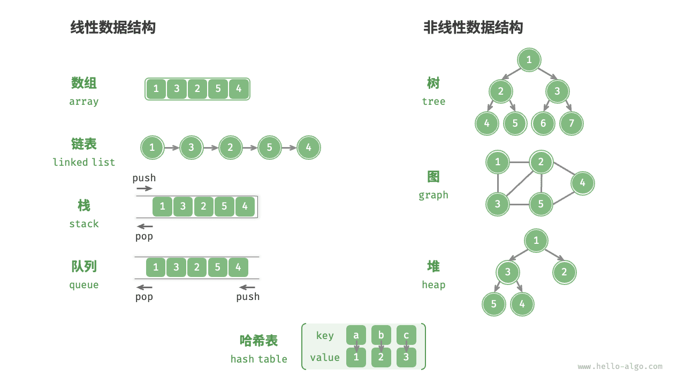
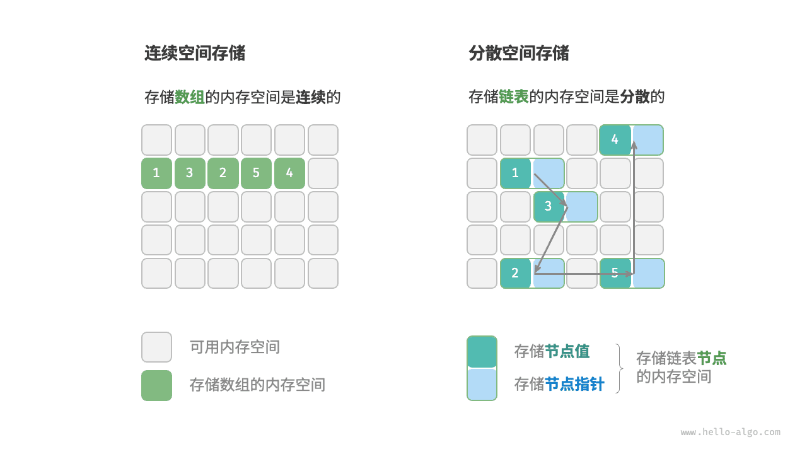

### 1. 按逻辑结构

* **线性数据结构**：数组、链表、栈、队列、哈希表，元素之间是一对一的顺序关系。
* **非线性数据结构**：树、堆、图、哈希表。

### 2. 按物理结构

* **连续空间存储**：数组
* **分散空间存储**：链表

**所有数据结构都是基于数组、链表或二者的组合实现的**。例如，栈和队列既可以使用数组实现，也可以使用链表实现；而哈希表的实现可能同时包含数组和链表。

- **基于数组可实现**：栈、队列、哈希表、树、堆、图、矩阵、张量（维度  的数组）等。
- **基于链表可实现**：栈、队列、哈希表、树、堆、图等。

### 其他补充内容

数字是以**“补码”**的形式**存储**在计算机中的。

- **原码**：我们将数字的二进制表示的最高位视为符号位，其中  表示正数， 表示负数，其余位表示数字的值。
- **反码**：正数的反码与其原码相同，负数的反码是对其原码除符号位外的所有位取反。
- **补码**：正数的补码与其原码相同，负数的补码是在其反码的基础上加  。

> 反码是为了处理负数诞生的
>
> 补码是为了处理+0、-0诞生的

**补码 1000 0000 是一个例外，它并没有对应的原码**。根据转换方法，我们得到该补码的原码为 0000 0000 。这显然是矛盾的，因为该原码表示数字  0，它的补码应该是自身。计算机规定这个特殊的补码 1000 0000 代表 -128 。实际上，(-1) + (-127) 在补码下的计算结果就是 -128 。